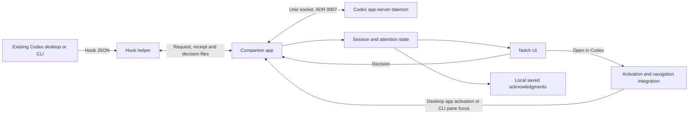

# Architecture draft

Status: proposed implementation shape. Agreed user experience is in [product.md](product.md); accepted decisions are in [adr](adr/0001-preserve-the-existing-codex-workflow.md). This draft predates the live integrations. Codex and Claude Code hooks, the terminal hosts and Claude Desktop are now implemented and documented in the integration docs listed in [AGENTS.md](../AGENTS.md#integration-safety-and-reference-routes), with live evidence in [evidence](evidence). The same core, app and helper split carries both agents: a second agent added its own hook entries and helper invocation rather than a generic agent framework. Read the diagram and identity sections below as the original shape, not a current inventory.

## Smallest useful structure

Use one Swift package with three targets: a shared core library, the macOS app, and a small command-line hook helper. Keep macOS focus and navigation code inside the app initially, separate from the core's state rules. These boundaries let us change the Codex transport or UI without rewriting the queue; they do not require a generic agent plugin framework.

The hook helper and the app never share a socket: the helper writes hook records and approval request files into Herdly's events directory, and the app answers with a receipt file and then a decision file. The only socket Herdly opens to Codex is the user's own app-server daemon, used to answer questions and send follow-up prompts ([ADR 0007](adr/0007-connect-to-the-codex-daemon-socket-as-the-same-user.md)). Desktop hook coverage is recorded in [desktop live integration](desktop-live-integration.md).

| Part | Owns | Does not own |
| --- | --- | --- |
| Core | Session activity, attention items, acknowledgments, deterministic event transitions, bounded record formats and their safe file access | AppKit, sockets, process launch, permission transport |
| macOS app | Notch, sound, focus observation, navigation, storage locations, integration coordination | Starting or supervising the user's Codex sessions |
| Hook helper | Decode Codex input, deliver bounded messages, arbitrate one permission response, emit Codex-compatible output | UI, conversation history, persistent permission rules |

Launch-at-login registration is a macOS app responsibility. The app maps `SMAppService.mainApp.status` into platform-neutral presentation state in HerdlyCore, but ServiceManagement registration and System Settings navigation stay in HerdlyApp. No duplicate enabled preference, login helper, or launch-agent plist is introduced.

## Model the identities separately

- Session identifies the ongoing conversation, qualified by its local runtime if needed. A project directory or title is not a unique session ID.
- Turn identifies one unit of Codex work. Finishing a turn does not close the session.
- Attention item identifies a particular completion or approval request. Acknowledging one completion does not acknowledge future completions.
- Surface locator identifies a desktop conversation or Ghostty tab. App identity alone cannot prove that the user visited a session.
- Approval interaction identifies one live helper invocation, bound to its originating session/turn, pending connection, and deadline. Do not route decisions using only a session ID or a command string.

## Status and approval paths

Status delivery must be quick and produce no model-visible output. Prefer non-blocking lifecycle hooks where the installed runtime supports them, accounting for their possible reordering; verify synchronous-only events separately. The app processes normalized events through one state owner. Connection loss must not stall Codex's work.

`UserPromptSubmit` supplies the working row's fallback text. `PreToolUse` supplies a bounded action description keyed by session, turn, and tool-use id; only the matching `PostToolUse` clears it. The helper retains no tool response and only the input strings needed to describe commands or file access. Replaying records after launch ignores older tool events so an unmatched pre-event cannot restore a stale action.

For a permission request, the helper writes a request file and waits for the companion's receipt file for at most `ApprovalTiming.connectionTimeout` (5 seconds). The receipt starts the agreed 30-second timer. A separate helper-side bound (`ApprovalTiming.helperWaitBound`, 121 seconds) prevents a stuck UI or a held deadline from extending the wait indefinitely. The app's count-down reflects the actual deadline.

The helper accepts only one terminal outcome: allow once, deny, or hand back with no decision. It arbitrates user action, deadline, disconnect, and handoff on one serialized path. A late button click is rejected rather than sent to a newer request. The app reports delivery state honestly; successful local delivery is not proof that Codex executed the requested action.

For any future verified desktop approval flow, foregrounding Codex hands back immediately; Ghostty uses originating-pane focus. Remove the decision controls without dismissing completions. Desktop approvals stay native until their integration and handoff policy are established. If the companion is absent or crashes, return no decision so Codex can continue its own approval flow. Never convert a connection error or timeout into approval. Do not synthesize terminal keystrokes to approve requests; the one relayed key is a question option the user chose, under ADR 0006.

After handoff, the queue can show Open in Codex while waiting for resolution evidence. Resolution is read from the session rollout: the exec call in the exact turn with the exact command whose terminal output was recorded after the companion receipt, plus turn completion, cancellation, or session end. This was verified against the installed CLI runtime for issue #10 ([approval reconciliation](approval-reconciliation.md)); desktop native answers remain unverified. The row never claims a request is still pending without evidence.

A question Codex asks the user (`request_user_input`) is read from the same rollout pass: the call is pending until an output for its call id, the end of its turn, or the end of its session, and its turn id comes from the call's passthrough metadata ([user-input requests](user-input-requests.md)). For a CLI session in Ghostty the companion relays the option the user chose in the notch as one key event to the exact matched terminal, after re-reading the rollout ([ADR 0006](adr/0006-relay-the-users-chosen-question-option-through-ghostty.md)); otherwise it points the user back to Codex. It never chooses an answer itself. When Codex's app-server daemon is running and holds the pending request, the companion answers exactly instead, by call id, as a second client on the daemon's socket ([ADR 0007](adr/0007-connect-to-the-codex-daemon-socket-as-the-same-user.md)). A session attached to that daemon is recorded as `vscode`, so a session is CLI when its rollout says `cli` or when its session-id title is among Ghostty's current tab titles.

A follow-up prompt typed on a completion card takes that same daemon socket and only it: `turn/start` on the thread the card is about, with no override of the thread's model, sandbox, approval policy or working directory. This is a source-level finding from the generated schema until a live run records a reply Codex took; the socket itself is proven. The Ghostty relay is verified for one key event, not for a whole prompt, so a session the daemon does not hold offers no reply field and the card says why; an ended session and a session Codex is mid-turn for — including one blocked on a question, whose running row is only withheld from the display — are refused for the same reason, that the target is gone or ambiguous. One card sends one reply, after re-reading the queue and the target; sending acknowledges nothing ([session replies](session-replies.md)).

## Focus and persistence

Desktop visibility uses Codex foreground, another app foreground, or unknown. Native app-activation observation is the candidate source; no selected-conversation query is required for the desktop MVP. Keep the shared notch visible regardless of foreground app or activity count. Foreground evidence still governs notification delivery and acknowledgment independently. Queue state is independent: explicit dismissal acknowledges desktop completions, and so does the desktop app's own unread flag clearing after the completion, read from its state file ([desktop read state](desktop-read-state.md)). Ghostty still uses this pane, another pane, or unknown. No activation, navigation success, or unknown state acknowledges desktop completions.

Agreed fallback: when focus cannot be identified reliably, retain the notification and let Codex handle approvals normally. Release any current hook wait with no decision, remove its decision controls, and reject later attempts to answer that interaction. A later successful focus probe does not reactivate the handed-back request.

Store small snapshots of attention items and completion acknowledgments locally with atomic replacement. A saved request cannot recreate a live approval connection. On restart, restore uncertain completions silently and revalidate request state before showing any active controls. Save only the metadata needed for the product; a full transcript store is unnecessary.

Implemented for issue #11 ([restart recovery](restart-recovery.md)): `AttentionSnapshotStore` keeps undismissed completions and acknowledgments in Herdly's own support directory; requests and running work are rebuilt from evidence on every scan. Completions held by the first scan after launch are marked uncertain and never replay a sound. Decision controls require a receipt issued by the running process; a receipt found on disk is released to Codex with no decision at once.

## Early evidence and integration checks

The 2026-09-11 evidence pass and the list of integration checks to run before choosing a transport have been superseded by the live integrations. Current facts live in the integration documents: [desktop live integration](desktop-live-integration.md) (bundle identity, desktop hook coverage), [desktop read state](desktop-read-state.md), [CLI integration](cli-notch-integration.md) and ADRs [0013](adr/0013-bind-cli-sessions-to-terminal-tabs-by-tty.md), [0015](adr/0015-raise-the-terminal-app-when-open-cannot-reach-the-exact-target.md) and [0016](adr/0016-open-and-acknowledge-visits-the-same-way-on-every-terminal-host.md) (terminal targeting), [approval reconciliation](approval-reconciliation.md) (handoff resolution, verified for the CLI), and [MVP acceptance](mvp-acceptance.md) (what has and has not been run live).

## Product decisions and remaining verification

- Queue ordering, separate working/to-check counts, and one notch on the actively used display are settled in product.md. Completion notifications expand for the card-open time (3 seconds by default) and remain open during interaction. Approval deadlines remain independent; only the pointer on the notch pauses them, never past 2 minutes from receipt (ADR 0020). Active-display selection and interaction freezing are pure rules in `NotchPlacement.swift` (issue #12, [notch placement](notch-placement.md)): the app supplies attached displays, the pointer, the current display, and whether the user is interacting; the core returns the display and frame. Screen-parameter changes only re-run placement.

## Hook scans and reminder queue

HerdlyCore ReminderReader reads no_decision approval records and matching session rollout completion records. Companion scans off the main actor, with only one scan in flight and scans at least two seconds apart, and applies results to ReminderQueue. A scan is due when a watched hook event directory changes (macOS file-system events, `HookDirectoryWatch`), an app is activated, or the app asks for one at once (a changed setting or events folder, or an answered approval leaving the queue, which also skips the two-second spacing); without that it still runs every two seconds while anything could change unseen, and every three seconds otherwise (`HookScanSchedule`, #306). "Could change unseen" (`HookScanNeeds`) is: no scan applied yet; a row or result held; a Codex or Claude session, subagent, daemon thread or fresh rollout candidate live; a Codex CLI process or the desktop app running, or an unreadable process table; Codex's hook folder not set, a Claude root read without a connected hook folder, or a source the last scan could not read; a Claude usage window resetting within three seconds; the notch open or Herdly active. A hook directory that is not watched, whose watch could not start, or whose watch reported its directory moved keeps the two-second clock; dropped or overflowed events make a scan due. The three-second scan is a safety net for the inputs nothing watches (rollouts, the process table, Claude's session registry and usage files, thread names, desktop read state, git branches) and for a file-system event that never arrives: three seconds plus the slowest refresh tick (one second) stays inside the hook helper's five-second connection timeout, so an approval is receipted rather than handed back even then (`receiptDeadlineOutlastsOneSafetyScanIntervalAndTheSlowestTick`). Each scan reuses what the previous one read from a rollout or a Codex or Claude hook record while the file's stamp (device, inode, size, modification time) is unchanged, so idle sessions are not reread; a rollout whose session holds an approval request, and the pre-send check before a relayed key, always read the file fresh. The queue merges observed requests, removes only completed session/turn identities, and retains items on read failure. Completed identities prevent resurrection during the process lifetime; restart reconstructs state from metadata and rollout records. Missing metadata on restart cannot restore an item. No Python runtime or Accessibility access is used.

Event-directory reads list at most 65,536 entries and decode only the newest 4,096 hook records (the Claude setup connection check instead decodes oldest first until its first startup proof), while Herdly deletes expired records itself (see [event retention](event-retention.md)). Reads are also capped at 50,000 rollout-directory entries, 1 MiB per record. A rollout is streamed: a longer line after the header (an image tool output, for example) is dropped as it is read rather than voiding the whole rollout, at most 256 MiB is read from disk and at most 32 MiB is kept, and a question asked before a dropped line is treated as unknown, never as pending. Duplicate rollout candidates and malformed/partial data retain reminders. Full scans are a known limit; incremental cursors would be needed for very large histories. Titles are not captured by approval metadata; the label is Codex's own thread name read from `~/.codex/session_index.jsonl` when one exists (desktop threads only), otherwise a shortened session ID (see [thread names](thread-names.md)).

Running work is also discovered from the newest rollouts alone for sessions with no hook event yet, gated by liveness evidence gathered in the app (desktop app running, Ghostty tab titles, a Codex CLI process, SessionEnd hooks); it feeds the same running rows and nothing else (see [session discovery](session-discovery.md)).

Terminal targeting (binding a CLI session to its tab or pane, Open and its fallback, and split tabs) is decided in ADRs [0013](adr/0013-bind-cli-sessions-to-terminal-tabs-by-tty.md), [0014](adr/0014-bind-multiplexer-panes-and-join-their-client-to-a-host-tab.md), [0015](adr/0015-raise-the-terminal-app-when-open-cannot-reach-the-exact-target.md) and [0016](adr/0016-open-and-acknowledge-visits-the-same-way-on-every-terminal-host.md), with implementation details in [CLI integration](cli-notch-integration.md).
