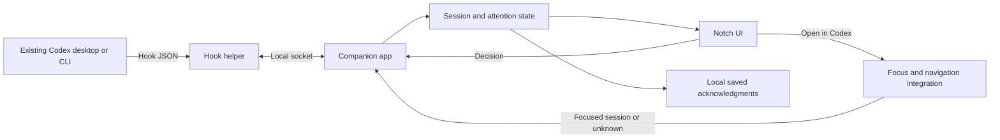

# Architecture draft

Status: proposed implementation shape. Agreed user experience is in [product.md](product.md); accepted decisions are in [adr](adr/0001-preserve-the-existing-codex-workflow.md). A [desktop capability probe](codex-desktop-investigation.md) has run successfully; no live session integration has been installed or verified.

## Smallest useful structure

Use one Swift package with three targets: a shared core library, the macOS app, and a small command-line hook helper. Keep macOS focus and navigation code inside the app initially, separate from the core's state rules. These boundaries let us change the Codex transport or UI without rewriting the queue; they do not require a generic agent plugin framework.

This diagram shows the candidate hook route. Desktop hook coverage and observing existing desktop sessions still need proof. App-server is a candidate supplementary source, not an assumption that launching a second server observes the user's existing conversations.

| Part | Owns | Does not own |
| --- | --- | --- |
| Core | Session activity, attention items, acknowledgments, deterministic event transitions | AppKit, sockets, process launch, permission transport |
| macOS app | Notch, sound, focus observation, navigation, local storage, integration coordination | Starting or supervising the user's Codex sessions |
| Hook helper | Decode Codex input, deliver bounded messages, arbitrate one permission response, emit Codex-compatible output | UI, conversation history, persistent permission rules |

## Model the identities separately

- Session identifies the ongoing conversation, qualified by its local runtime if needed. A project directory or title is not a unique session ID.
- Turn identifies one unit of Codex work. Finishing a turn does not close the session.
- Attention item identifies a particular completion or approval request. Acknowledging one completion does not acknowledge future completions.
- Surface locator identifies a desktop conversation or Ghostty terminal pane. App identity alone cannot prove that the user visited a session.
- Approval interaction identifies one live helper invocation, bound to its originating session/turn, pending connection, and deadline. Do not route decisions using only a session ID or a command string.

## Status and approval paths

Status delivery must be quick and produce no model-visible output. Prefer non-blocking lifecycle hooks where the installed runtime supports them, accounting for their possible reordering; verify synchronous-only events separately. The app processes normalized events through one state owner. Connection loss must not stall Codex's work.

For a permission request, the helper connects to the companion with a short connection deadline. If the companion can handle the request, receipt starts the agreed 30-second timer. A separate bounded helper-side timeout prevents a stuck UI or missed receipt from extending the wait indefinitely. The app's count-down reflects the actual deadline.

The helper accepts only one terminal outcome: allow once, deny, or hand back with no decision. It arbitrates user action, deadline, disconnect, and handoff on one serialized path. A late button click is rejected rather than sent to a newer request. The app reports delivery state honestly; successful local delivery is not proof that Codex executed the requested action.

When the originating session is focused, hand back immediately and remove the notch's decision controls. If the companion is absent or crashes, return no decision so Codex can continue its own approval flow. Never convert a connection error or timeout into approval. Do not synthesize terminal keystrokes to approve requests.

After handoff, the queue can show Open in Codex while waiting for resolution evidence. Determining resolution through installed-runtime events remains a verification requirement; do not keep claiming a request is pending indefinitely without evidence.

## Focus and persistence

Treat focus as one of: this session, another session, or unknown. Unknown must not be silently treated as proof of acknowledgment. Use native app-activation information and targeted queries for the supported host, not broad continuous screen capture.

Agreed fallback: when focus cannot be identified reliably, retain the notification and let Codex handle approvals normally. Release any current hook wait with no decision, remove its decision controls, and reject later attempts to answer that interaction. A later successful focus probe does not reactivate the handed-back request.

Store small snapshots of attention items and completion acknowledgments locally with atomic replacement. A saved request cannot recreate a live approval connection. On restart, restore uncertain completions silently and revalidate request state before showing any active controls. Save only the metadata needed for the product; a full transcript store is unnecessary.

## Evidence checked on 2026-09-11

- Installed Ghostty is 1.3.1. Its local scripting dictionary includes stable terminal IDs, focused terminal, selected tab, and focus. The [official AppleScript reference](https://ghostty.org/docs/features/applescript) documents these APIs. Mapping a Codex session to the exact pane still needs a live test, especially for two panes in the same directory.
- The desktop bundle at /Applications/ChatGPT.app identifies as com.openai.codex, version 26.901.51231, and registers the codex URL scheme. Its bundled CLI reports 0.153.4; the shell CLI reports 0.145.0. Multiple installed bundles share that identity, so resolve the running process's bundle path rather than choosing by ID alone. The installed deep-link handler recognizes threads, but live return to a specific conversation remains unverified.
- The desktop's local scripting dictionary has generic window/tab APIs; these are not evidence of a stable focused Codex conversation identifier.
- [Codex hooks](https://learn.chatgpt.com/docs/hooks) document synchronous PermissionRequest decisions and no-decision fallback. Background hooks cannot approve. This establishes the candidate contract, not installed-version parity or coverage of every approval type.
- [App-server](https://learn.chatgpt.com/docs/app-server) documents request-resolution notifications and local transports. Attaching to the existing runtime, ownership of requests, hook coverage, and exact desktop focus remain unverified. thread/read fetches data rather than proving user acknowledgment.
- The first desktop probe confirms these protocol definitions in the installed bundled CLI. Source inspection additionally found private conversation-level read-state broadcasts, not a verified external focus or per-completion acknowledgment API. See the [investigation](codex-desktop-investigation.md) for evidence and the live UI access limitation.

## Required integration checks before committing to transport

1. In disposable CLI and desktop tasks, prove start, completion, permission, allow, deny, and no-decision handoff separately. Include the actual approval types the user encounters; unsupported ones must stay in Codex's native flow.
2. Kill the companion during a pending request and verify the native approval returns. Exercise deadline/click races and late messages with two simultaneous requests.
3. Map two Ghostty panes in the same project to their distinct Codex sessions; verify focus detection and navigation across tabs, splits, and windows.
4. Identify the desktop's selected conversation without changing it. Verify that a different conversation does not acknowledge the completed one.
5. After handoff, detect a decision made in Codex and clear only the matching item. Restart the companion and prove saved requests do not produce active approval buttons.

These are planned checks, not completed tests. Existing user configuration has not been changed.

## Product decisions and remaining verification

- Queue ordering, separate working/to-check counts, and one notch on the actively used display are settled in product.md. Completion notifications expand for three seconds and remain open during interaction. Approval deadlines remain independent and are never extended by interaction. Active-display detection and interaction stability need implementation detail and verification.
