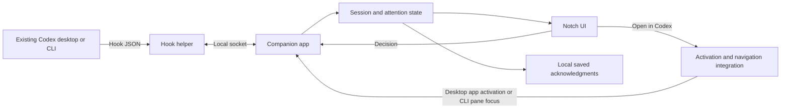

# Architecture draft

Status: proposed implementation shape. Agreed user experience is in [product.md](product.md); accepted decisions are in [adr](adr/0001-preserve-the-existing-codex-workflow.md). A [desktop capability probe](codex-desktop-investigation.md) has run successfully; no live session integration has been installed or verified.

## Smallest useful structure

Use one Swift package with three targets: a shared core library, the macOS app, and a small command-line hook helper. Keep macOS focus and navigation code inside the app initially, separate from the core's state rules. These boundaries let us change the Codex transport or UI without rewriting the queue; they do not require a generic agent plugin framework.

This diagram shows the candidate hook route. Desktop hook coverage and observing existing desktop sessions still need proof. App-server is a candidate supplementary source, not an assumption that launching a second server observes the user's existing conversations.

| Part | Owns | Does not own |
| --- | --- | --- |
| Core | Session activity, attention items, acknowledgments, deterministic event transitions, bounded record formats and their safe file access | AppKit, sockets, process launch, permission transport |
| macOS app | Notch, sound, focus observation, navigation, storage locations, integration coordination | Starting or supervising the user's Codex sessions |
| Hook helper | Decode Codex input, deliver bounded messages, arbitrate one permission response, emit Codex-compatible output | UI, conversation history, persistent permission rules |

## Model the identities separately

- Session identifies the ongoing conversation, qualified by its local runtime if needed. A project directory or title is not a unique session ID.
- Turn identifies one unit of Codex work. Finishing a turn does not close the session.
- Attention item identifies a particular completion or approval request. Acknowledging one completion does not acknowledge future completions.
- Surface locator identifies a desktop conversation or Ghostty tab. App identity alone cannot prove that the user visited a session.
- Approval interaction identifies one live helper invocation, bound to its originating session/turn, pending connection, and deadline. Do not route decisions using only a session ID or a command string.

## Status and approval paths

Status delivery must be quick and produce no model-visible output. Prefer non-blocking lifecycle hooks where the installed runtime supports them, accounting for their possible reordering; verify synchronous-only events separately. The app processes normalized events through one state owner. Connection loss must not stall Codex's work.

`UserPromptSubmit` supplies the working row's fallback text. `PreToolUse` supplies a bounded action description keyed by session, turn, and tool-use id; only the matching `PostToolUse` clears it. The helper retains no tool response and only the input strings needed to describe commands or file access. Replaying records after launch ignores older tool events so an unmatched pre-event cannot restore a stale action.

For a permission request, the helper connects to the companion with a short connection deadline. If the companion can handle the request, receipt starts the agreed 30-second timer. A separate bounded helper-side timeout prevents a stuck UI or missed receipt from extending the wait indefinitely. The app's count-down reflects the actual deadline.

The helper accepts only one terminal outcome: allow once, deny, or hand back with no decision. It arbitrates user action, deadline, disconnect, and handoff on one serialized path. A late button click is rejected rather than sent to a newer request. The app reports delivery state honestly; successful local delivery is not proof that Codex executed the requested action.

For any future verified desktop approval flow, foregrounding Codex hands back immediately; Ghostty uses originating-pane focus. Remove the decision controls without dismissing completions. Desktop approvals stay native until their integration and handoff policy are established. If the companion is absent or crashes, return no decision so Codex can continue its own approval flow. Never convert a connection error or timeout into approval. Do not synthesize terminal keystrokes to approve requests; the one relayed key is a question option the user chose, under ADR 0006.

After handoff, the queue can show Open in Codex while waiting for resolution evidence. Resolution is read from the session rollout: the exec call in the exact turn with the exact command whose terminal output was recorded after the companion receipt, plus turn completion, cancellation, or session end. This was verified against the installed CLI runtime for issue #10 ([approval reconciliation](approval-reconciliation.md)); desktop native answers remain unverified. The row never claims a request is still pending without evidence.

A question Codex asks the user (`request_user_input`) is read from the same rollout pass: the call is pending until an output for its call id, the end of its turn, or the end of its session, and its turn id comes from the call's passthrough metadata ([user-input requests](user-input-requests.md)). For a CLI session in Ghostty the companion relays the option the user chose in the notch as one key event to the exact matched terminal, after re-reading the rollout ([ADR 0006](adr/0006-relay-the-users-chosen-question-option-through-ghostty.md)); otherwise it points the user back to Codex. It never chooses an answer itself. When Codex's app-server daemon is running and holds the pending request, the companion answers exactly instead, by call id, as a second client on the daemon's socket ([ADR 0007](adr/0007-connect-to-the-codex-daemon-socket-as-the-same-user.md)). A session attached to that daemon is recorded as `vscode`, so a session is CLI when its rollout says `cli` or when its session-id title is among Ghostty's current tab titles.

A follow-up prompt typed on a completion card takes that same daemon socket and only it: `turn/start` on the thread the card is about, with no override of the thread's model, sandbox, approval policy or working directory. This is a source-level finding from the generated schema until a live run records a reply Codex took; the socket itself is proven. The Ghostty relay is verified for one key event, not for a whole prompt, so a session the daemon does not hold offers no reply field and the card says why; an ended session and a session Codex is mid-turn for — including one blocked on a question, whose running row is only withheld from the display — are refused for the same reason, that the target is gone or ambiguous. One card sends one reply, after re-reading the queue and the target; sending acknowledges nothing ([session replies](session-replies.md)).

## Focus and persistence

Desktop visibility uses Codex foreground, another app foreground, or unknown. Native app-activation observation is the candidate source; no selected-conversation query is required for the desktop MVP. Keep the shared notch visible regardless of foreground app or activity count. Foreground evidence still governs notification delivery and acknowledgment independently. Queue state is independent: explicit dismissal acknowledges desktop completions, and so does the desktop app's own unread flag clearing after the completion, read from its state file ([desktop read state](desktop-read-state.md)). Ghostty still uses this pane, another pane, or unknown. No activation, navigation success, or unknown state acknowledges desktop completions.

Agreed fallback: when focus cannot be identified reliably, retain the notification and let Codex handle approvals normally. Release any current hook wait with no decision, remove its decision controls, and reject later attempts to answer that interaction. A later successful focus probe does not reactivate the handed-back request.

Store small snapshots of attention items and completion acknowledgments locally with atomic replacement. A saved request cannot recreate a live approval connection. On restart, restore uncertain completions silently and revalidate request state before showing any active controls. Save only the metadata needed for the product; a full transcript store is unnecessary.

Implemented for issue #11 ([restart recovery](restart-recovery.md)): `AttentionSnapshotStore` keeps undismissed completions and acknowledgments in Steer's own support directory; requests and running work are rebuilt from evidence on every scan. Completions held by the first scan after launch are marked uncertain and never replay a sound. Decision controls require a receipt issued by the running process; a receipt found on disk is released to Codex with no decision at once.

## Evidence checked on 2026-09-11

- Installed Ghostty is 1.3.1. Its local scripting dictionary includes stable terminal IDs, focused terminal, selected tab, and focus. The [official AppleScript reference](https://ghostty.org/docs/features/applescript) documents these APIs. Mapping a Codex session to the exact pane still needs a live test, especially for two panes in the same directory.
- The desktop bundle at /Applications/ChatGPT.app identifies as com.openai.codex, version 26.901.51231, and registers the codex URL scheme. Its bundled CLI reports 0.153.4; the shell CLI reports 0.145.0. Multiple installed bundles share that identity, so resolve the running process's bundle path rather than choosing by ID alone. The user verified task-link return from Codex and Apple Notes; exact installation routing remains unverified.
- The desktop's local scripting dictionary has generic window/tab APIs; these are not evidence of a stable focused Codex conversation identifier.
- [Codex hooks](https://learn.chatgpt.com/docs/hooks) document synchronous PermissionRequest decisions and no-decision fallback. Background hooks cannot approve. This establishes the candidate contract, not installed-version parity or coverage of every approval type.
- [App-server](https://learn.chatgpt.com/docs/app-server) documents request-resolution notifications and local transports. Attaching to the existing runtime, ownership of requests, hook coverage, and app-activation observation remain unverified. Exact desktop task focus is deferred. thread/read fetches data rather than proving user acknowledgment.
- The first desktop probe confirms these protocol definitions in the installed bundled CLI. Source inspection additionally found private conversation-level read-state broadcasts, not a verified external focus or per-completion acknowledgment API. See the [investigation](codex-desktop-investigation.md) for evidence and the live UI access limitation.

## Required integration checks before committing to transport

1. In disposable CLI and desktop tasks, prove start, completion, permission, allow, deny, and no-decision handoff separately. Include the actual approval types the user encounters; unsupported ones must stay in Codex's native flow.
2. Kill the companion during a pending request and verify the native approval returns. Exercise deadline/click races and late messages with two simultaneous requests.
3. Map two unsplit Ghostty tabs in the same project to their distinct Codex sessions; verify focus detection and navigation across tabs and windows. Split-pane targeting is deferred; reject split or ambiguous targets.
4. Verify desktop foreground/background visibility using native app activation, including activation while a popup is expanded. Neither task navigation nor foregrounding acknowledges completions; explicit dismissal and the desktop app's own cleared unread flag do. Test queued completions received while foreground and prevent repeat sound on subsequent switches. Exact desktop conversation focus is deferred.
5. After handoff, detect a decision made in Codex and clear only the matching item. Restart the companion and prove saved requests do not produce active approval buttons.

Check 5 is recorded for the CLI in [approval reconciliation](approval-reconciliation.md); the remaining desktop checks are still planned. Existing user configuration has not been changed.

## Product decisions and remaining verification

- Queue ordering, separate working/to-check counts, and one notch on the actively used display are settled in product.md. Completion notifications expand for three seconds and remain open during interaction. Approval deadlines remain independent and are never extended by interaction. Active-display selection and interaction freezing are pure rules in `NotchPlacement.swift` (issue #12, [notch placement](notch-placement.md)): the app supplies attached displays, the pointer, the current display, and whether the user is interacting; the core returns the display and frame. Screen-parameter changes only re-run placement.

## Reminder queue integration — 2026-09-11

SteerCore ReminderReader reads no_decision approval records and matching session rollout completion records. Companion polls off the main actor every two seconds, with only one scan in flight, and applies results to ReminderQueue. The queue merges observed requests, removes only completed session/turn identities, and retains items on read failure. Completed identities prevent resurrection during the process lifetime; restart reconstructs state from metadata and rollout records. Missing metadata on restart cannot restore an item. No Python runtime or Accessibility access is used.

Reads are capped at 4,096 event-directory entries, 50,000 rollout-directory entries, 32 MiB per rollout and 1 MiB per record. Duplicate rollout candidates and malformed/partial data retain reminders. Full scans are a deliberate prototype limit; incremental cursors are needed for large histories. Titles are not captured by approval metadata; the label is Codex's own thread name read from `~/.codex/session_index.jsonl` when one exists (desktop threads only), otherwise a shortened session ID (see [thread names](thread-names.md)).

Running work is also discovered from the newest rollouts alone for sessions with no hook event yet, gated by liveness evidence gathered in the app (desktop app running, Ghostty tab titles, a Codex CLI process, SessionEnd hooks); it feeds the same running rows and nothing else (see [session discovery](session-discovery.md)).

The issue #3 integration extends the existing reader and queue with CLI source classification and completion-specific acknowledgments. Native Ghostty navigation lives inside the app, with its pure matcher in SteerCore. See [implementation and verification boundaries](cli-notch-integration.md).

## Ghostty scope revision

ADR 0004 defers targeting within split tabs. Target the originating unsplit tab/window. This reduces verification cases but does not prove a stable session-to-tab binding on Ghostty 1.3.1.
